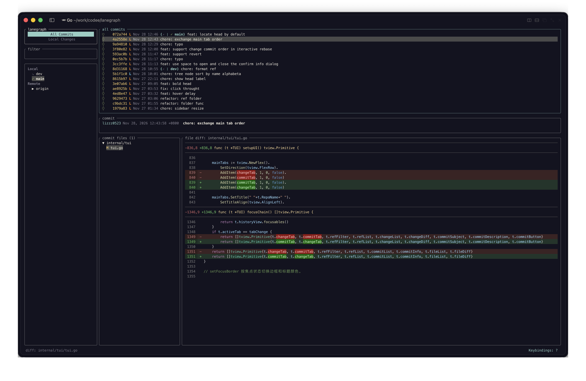

# lanegraph

English | [简体中文](README.zh-CN.md)

A terminal UI for Git.



## Installation

Requires Go 1.24 or later:

```sh
go install github.com/lizzz0523/lanegraph@latest
```

Or build from source:

```sh
git clone https://github.com/lizzz0523/lanegraph.git
cd lanegraph
go install .
```

The binary is placed in `$GOBIN` (`$(go env GOPATH)/bin` if unset); make sure it is on your `PATH`.

### Better diff display

lanegraph auto-detects a diff highlighter on `PATH`, preferring `git-split-diffs`, then `git-delta`:

```sh
npm install -g git-split-diffs   # or
brew install git-delta
```

Built-in basic highlighting is used when neither is installed.

## Usage

```sh
lanegraph            # open the repository in the current directory
lanegraph /path/repo # open a specific repository
```

Press `?` to show key bindings, `q` to quit.
